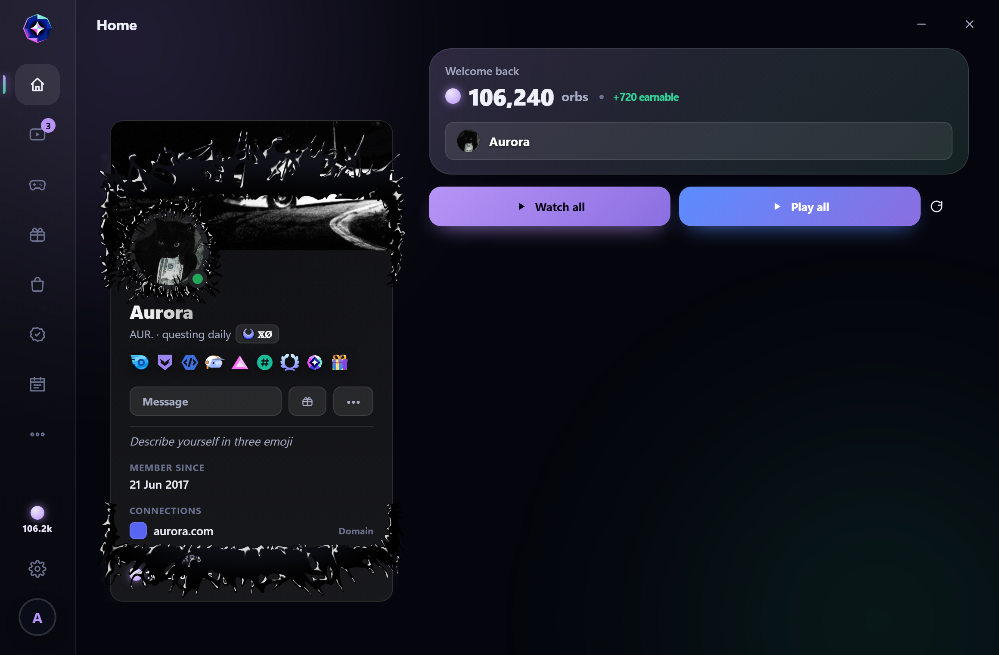
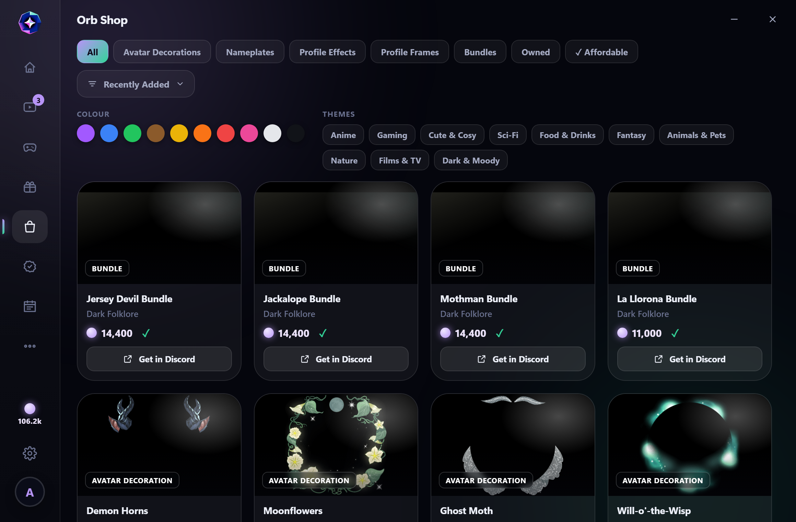
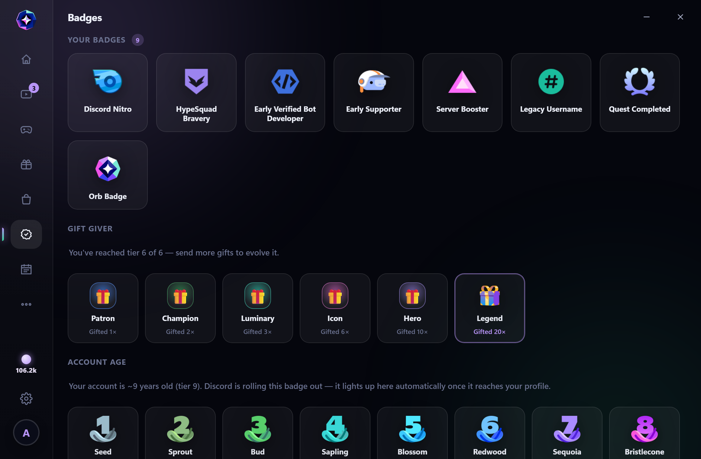
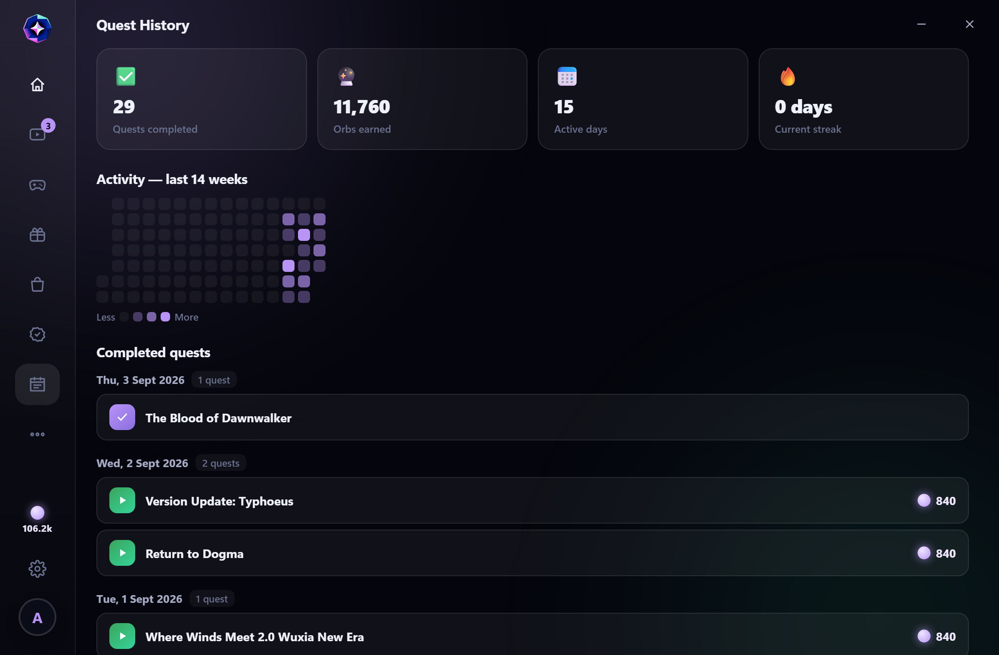

<div align="center">


# Aurora Quests

**A fast, modern, native viewer &amp; completer for Discord Quests.**

A single portable binary — Rust + a system WebView, no installer, no Electron —
that reads the Quests from your locally signed-in Discord client and gives them a
proper home: watch, play, claim, shop, badges and profile customisation, all in
one window.


</div>

---

<div align="center">

</div>

<table>
<tr>
<td width="50%"><br/><sub><b>Watch Videos</b> — every video quest as a card, with an orbs-only filter and sorting.</sub></td>
<td width="50%"><br/><sub><b>Orb Shop</b> — the real collectibles shop with colour, theme and “affordable” filters.</sub></td>
</tr>
<tr>
<td width="50%"><br/><sub><b>Badges</b> — your real badges plus the full evolving-tier ladders.</sub></td>
<td width="50%"><br/><sub><b>History</b> — all-time stats, a 14-week activity heatmap and a completed-quest log.</sub></td>
</tr>
</table>

## Features

- **Watch &amp; Play tabs** — every video and game quest, with an *orbs-only* filter,
  sorting (suggested / recent / expiring / started) and an expiring-soon flag.
- **Watch videos in-app** — quests play muted in a docked player and count toward
  progress; *Watch-all* / *Play-all* run through them one after another.
- **Claim tab** — collect finished rewards from inside the app in one click.
- **Orb Shop** — the real collectibles shop with colour / theme / category filters,
  sorting, an *affordable now* view, and an orb goal you can pin to the homepage.
- **Badges** — your real Discord badges with the full evolving-tier ladders.
- **Profile studio** — preview every decoration, nameplate, profile effect, frame,
  name style and two-colour theme on a live Discord-style card, and export edited
  avatars &amp; banners.
- **Custom Rich Presence** — a click-to-edit, Discord-style activity editor (see the
  *Misc* tab).
- **Homepage** — your real equipped profile plus all-time stats.
- **Quality of life** — system tray, optional desktop notifications, light/dark theme
  + accent picker, launch-on-startup, and built-in auto-update from GitHub Releases.

## Install

### Windows

Download the latest `discord_quests.exe` from
[**Releases**](../../releases) and run it — no installation. It updates itself when a
new release is published. Windows 11 already ships the WebView2 runtime it needs.

### Linux (Arch)

Grab `discord_quests-linux-x86_64` from [**Releases**](../../releases) (built on
Ubuntu by CI, runs on Arch), make it executable and run it:

```bash
chmod +x discord_quests-linux-x86_64
./discord_quests-linux-x86_64
```

It needs a WebKitGTK runtime and a few common libraries — all in the official repos:

```bash
sudo pacman -S --needed webkit2gtk-4.1 gtk3 libayatana-appindicator \
                        libsecret libnotify xdg-utils
```

- `webkit2gtk-4.1`, `gtk3` — the WebView the UI renders in.
- `libayatana-appindicator` — the system-tray icon.
- `libsecret` — reads your Discord token key from the login keyring (`secret-tool`).
- `libnotify`, `xdg-utils` — desktop notifications (`notify-send`) and opening links
  (`xdg-open`).

> Aurora looks for Discord under `~/.config/{discord,discordptb,discordcanary}` and
> the official Flatpak (`~/.var/app/com.discordapp.Discord`). Its own settings live in
> `~/.config/AuroraQuests`.

## Build from source

Requires the [Rust toolchain](https://rustup.rs). On Linux you also need the runtime
libraries above **plus** their development headers and `pkgconf`:

```bash
# Arch build dependencies
sudo pacman -S --needed base-devel rust pkgconf \
                        webkit2gtk-4.1 gtk3 libayatana-appindicator \
                        libsecret libnotify xdg-utils
```

Then, on either platform:

```bash
cargo build --release
# Windows → target/release/discord_quests.exe
# Linux   → target/release/discord_quests
```

Handy headless flags: `--list` prints your quests to the terminal; `--html` renders
the live UI to a temporary HTML file for design previews.

## How it works

Aurora never asks you to paste anything. It reads the auth token from your **locally
installed** Discord client the same way the client itself does — decrypting it with
the OS key store (DPAPI on Windows, the Chromium *Safe Storage* key from your login
keyring on Linux) — then talks to Discord’s own Quest endpoints on your behalf. It
identifies itself to Discord as the desktop client for the OS you’re running, so the
full quest set (including watch-video quests) is returned. Everything stays on your
machine.

## ⚠️ Disclaimer

This automates quest completion and sets presence using your Discord **account
token**, which is against Discord’s Terms of Service. It only ever touches your
**own** account, for your **own** rewards, and your data stays on your machine — but
there is a small account risk. Use at your own discretion.
